# Screenshots

iPhone 15 Pro Max, iOS 26.

| Deck list | Reviewing: question | Reviewing: answer |
| :---: | :---: | :---: |
| 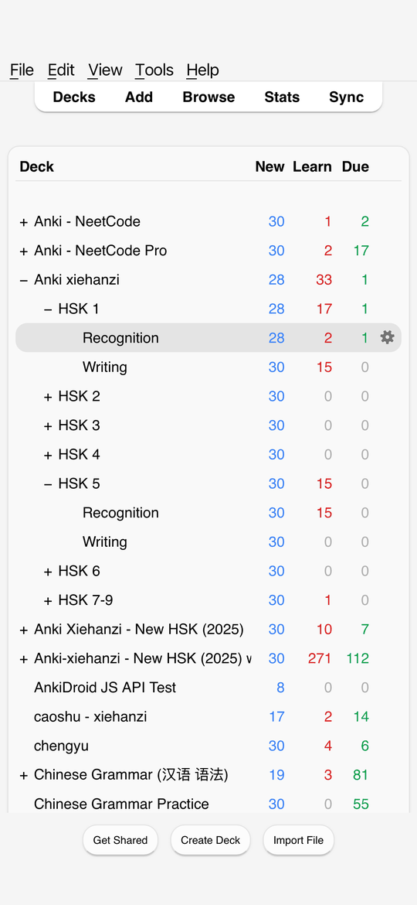 | 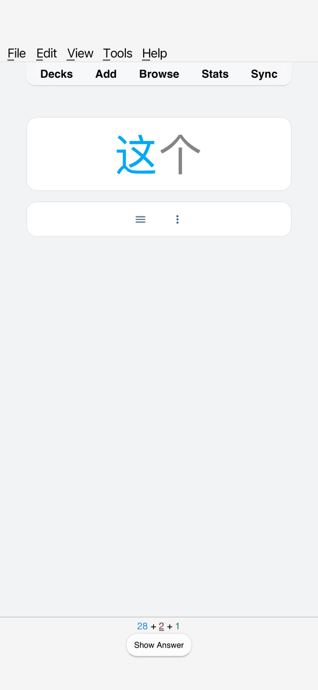 | 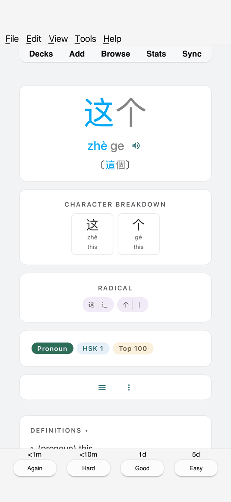 |

| Reviewing a NeetCode card | Browse | Statistics |
| :---: | :---: | :---: |
| 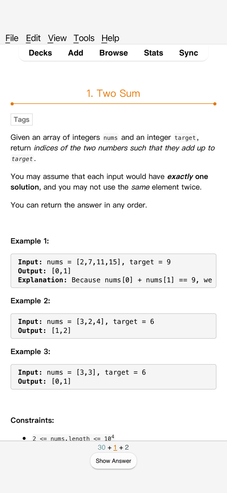 | 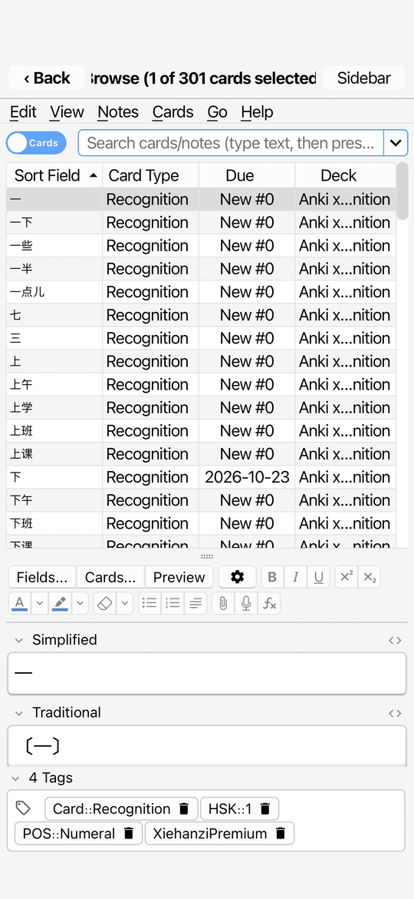 | 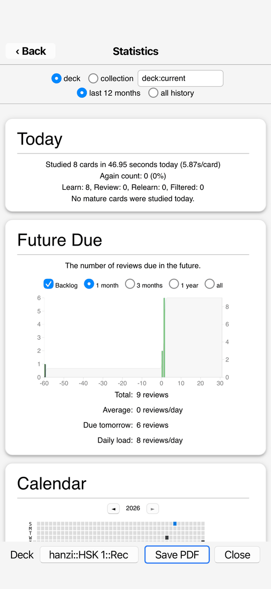 |

| Add |
| :---: |
| 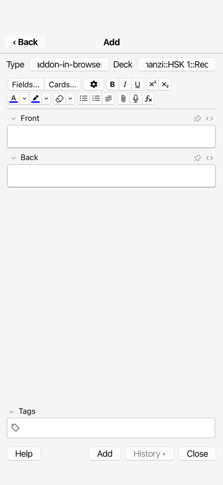 |

| Add-ons with Extra Files | Extra Files |
| :---: | :---: |
| 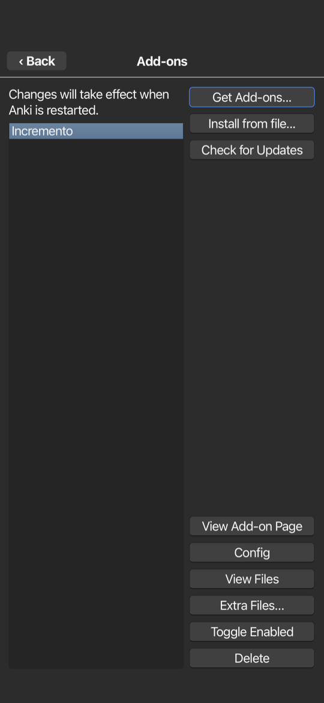 | 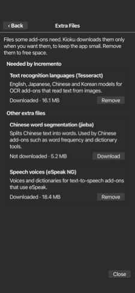 |

## Self-hosted server (Docker)

Anki desktop on the server, in Chrome (taken by `desktop/test/run.sh`).

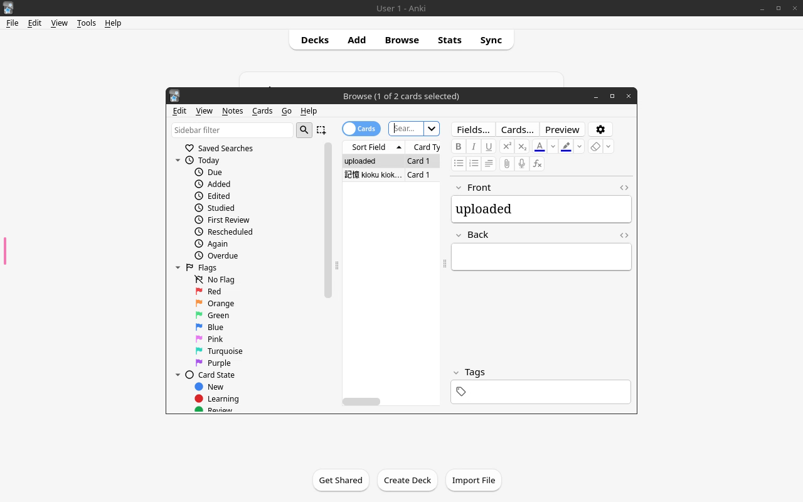

| Phone, `ANKI_FIT_SCREEN` | Browse on a phone |
| :---: | :---: |
| 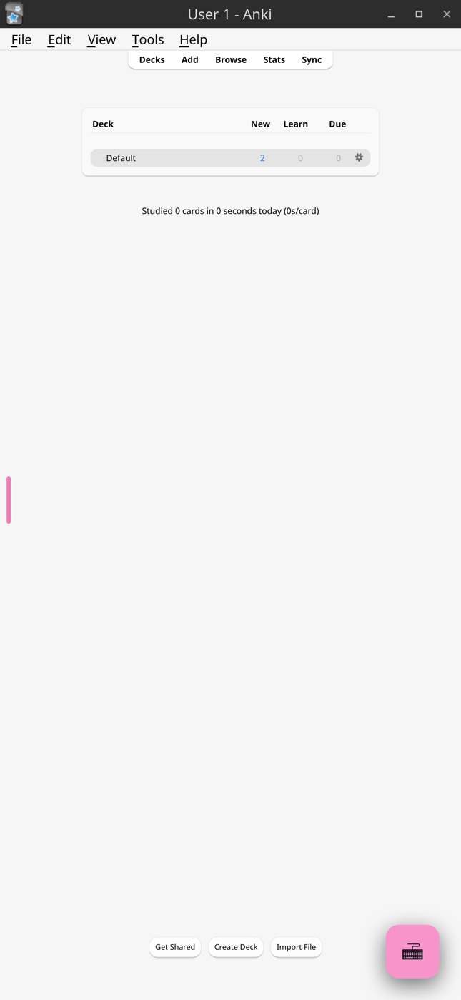 | 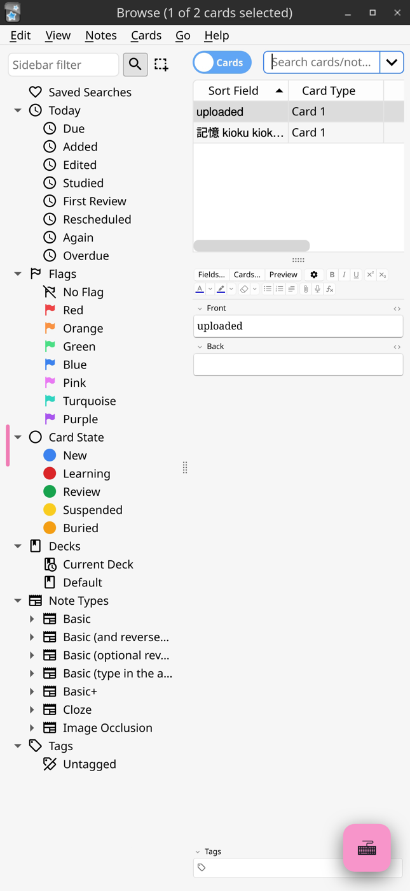 |
